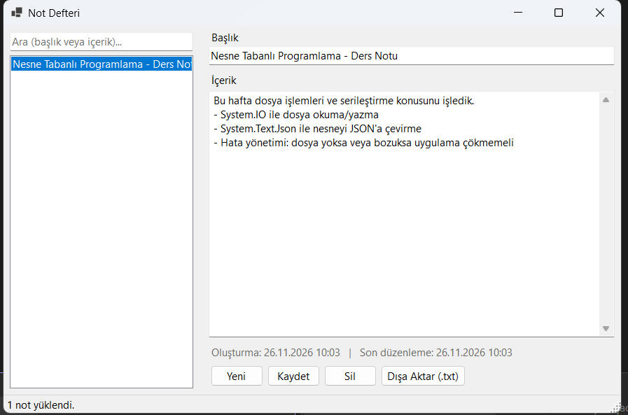
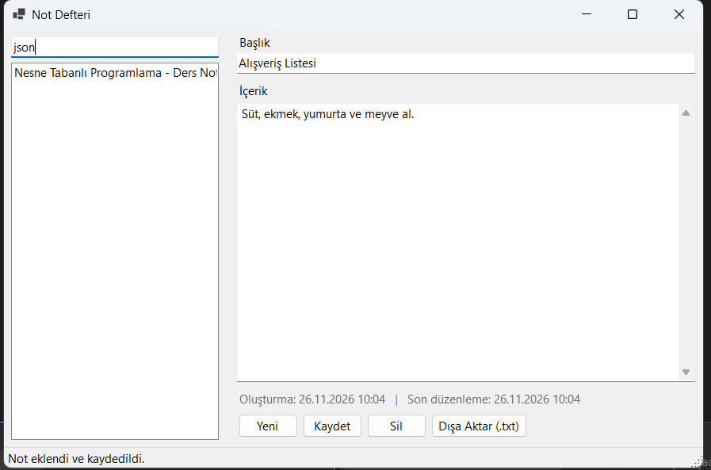

# Not Defteri (YMH219-NotepadApp)

Notları bilgisayarda kalıcı olarak saklayan basit bir Windows Forms not defteri uygulaması.
Nesne Tabanlı Programlama (YMH 219) dersi ek uygulama ödevi olarak geliştirilmiştir.
Odak: dosya işlemleri (File I/O) ve JSON serileştirme.

## Kullanılan Teknolojiler
- C# / .NET 10 (Windows Forms)
- `System.Text.Json` (serileştirme) — ek NuGet paketi gerekmez
- `System.IO` (dosya okuma/yazma)

## Kurulum ve Çalıştırma
1. Depoyu klonlayın: `git clone https://github.com/cumalibilgic/YMH219-NotepadApp.git`
2. `YMH219-NotepadApp.csproj` dosyasını Visual Studio 2022+ ile açın (.NET 10 SDK gerekir).
3. `F5` ile çalıştırın. Komut satırından: `dotnet run`

## Temel Özellikler
- Başlık + içerikten oluşan not ekleme, listeleme, düzenleme ve silme
- Notlar `%AppData%\NotDefteri\notlar.json` dosyasına JSON olarak kaydedilir ve uygulama açılınca otomatik yüklenir
- Seçili notu düz metin (`.txt`) olarak dışa aktarma
- Her notun oluşturma ve son düzenleme tarihi tutulur
- Başlığa veya içeriğe göre arama/filtreleme (isteğe bağlı geliştirme)
- Hata yönetimi: dosya yoksa boş başlar, bozuk JSON `.bozuk` olarak yedeklenir, yazma hataları kullanıcıya bildirilir
- Her kaydetme/silme işleminden sonra otomatik olarak diske yazılır

## Proje Yapısı
- `Models/Not.cs` — Not sınıfı (Id, Başlık, İçerik, tarihler)
- `Services/NotDeposu.cs` — `List<Not>` yönetimi, JSON kaydet/yükle, .txt dışa aktarma
- `MainForm.cs` — arayüz ve olay yönetimi

## Ekran Görüntüleri

## Bilinen Sınırlamalar / Geliştirme Notları
- Kaydedilmemiş değişiklikler, başka nota geçilirken uyarı vermeden atılır.
- Düz metin düzenleyici kullanılır; zengin metin (RichTextBox) desteği yoktur.
- Kategori/etiket desteği henüz yoktur.

## Öğrenci
Cumali Bilgiç — 250541008
